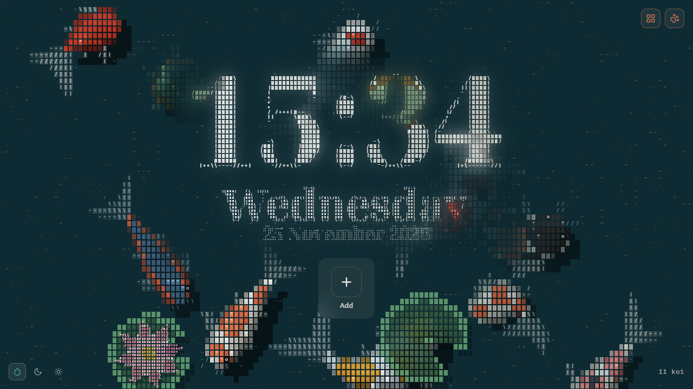
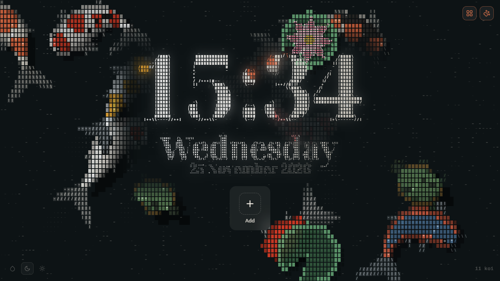
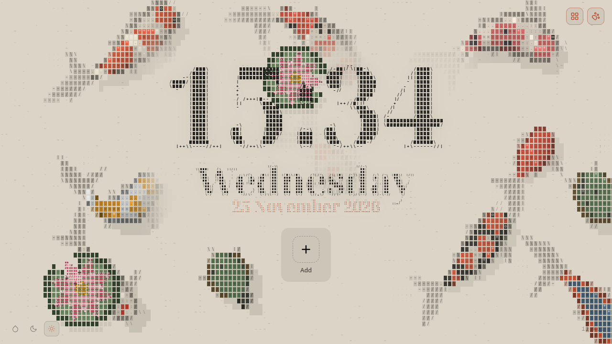

# ASCII Koi

**An interactive ASCII koi pond for your Chrome New Tab page.** Watch koi, fancy goldfish, and pond turtles swim beneath drifting lily pads and ASCII lotus blooms while your clock, day, and date shimmer with the water below.



## Features

- **Living ASCII Pond**: Features koi varieties (Kohaku, Sanke, Tancho, Showa, Asagi, Ogon), Fancy Goldfish (Ryukin), and Small Pond Turtles with crisp ASCII outlines, depth sorting, and randomized positions on every new tab.
- **Drifting Lily Pads & ASCII Lotus**: Up to two lily pads slowly drift and rotate across the pond, with one or both blooming into layered ASCII lotus flowers.
- **Interactive Water**:
  - **Left-click** anywhere on the water to dip a cat paw and send ripples across the pond (can be toggled on/off with the top-right paw button).
  - **Right-click** to scatter fish food pellets that draw koi and goldfish to the surface.
  - **Space** pauses or resumes the pond; animations also auto-pause when the tab is hidden to save battery.
- **ASCII Clock, Day & Date**: Rendered in *Noto Serif Display* as live ASCII character cells that pick up the colors and caustic light of the fish swimming underneath.
- **Three Water Themes**: Switch between **Pond** (`1`), **Black** (`2`), and **Light** (`3`) using the bottom-left theme switcher or keyboard shortcuts.
- **Quick-Access Shortcuts Dock**: Glassmorphic shortcuts bar with favicons, add/edit/delete actions, drag-and-drop reordering, `chrome.storage.sync` backup across Chrome profiles, and a top-right visibility toggle.

## Themes

| Pond | Black | Light |
| :---: | :---: | :---: |
|  |  |  |

## Install (Chrome / Edge)

1. Clone or download this repository:
   ```bash
   git clone https://github.com/demon2202/ascii-koi.git
   ```
2. Open `chrome://extensions` in Chrome.
3. Enable **Developer mode** (top right).
4. Click **Load unpacked** and select the `ascii-koi` folder.
5. Open a new tab to see the pond.

## Controls

| Input | Action |
| --- | --- |
| **Left-click** | Dip cat paw & ripple water (when paw mode is on) |
| **Right-click** | Toss fish food pellets |
| **1 / 2 / 3** | Switch between Pond, Black, and Light themes |
| **Space** | Pause / resume animation |
| **Top-right buttons** | Toggle shortcuts dock visibility / toggle cat paw |

## Files

| File | Role |
| --- | --- |
| `manifest.json` | Chrome MV3 extension manifest (`newtab` override, `favicon`, `storage`) |
| `index.html` | New Tab page structure and top-right / bottom-left controls |
| `pond.css` | Theme tokens (`pond`, `black`, `light`), glass dock, and responsive layout |
| `pond.js` | ASCII pond simulation, species, lily pads, lotus, cat paw, and `AsciiMark` |
| `app.js` | Clock/day/date updates, theme switching, shortcuts dock, drag-and-drop, `chrome.storage.sync` |
| `fonts/` | Bundled *Noto Serif Display* and *Geist Mono* webfonts |

## License

MIT
